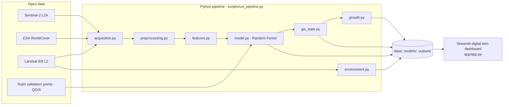
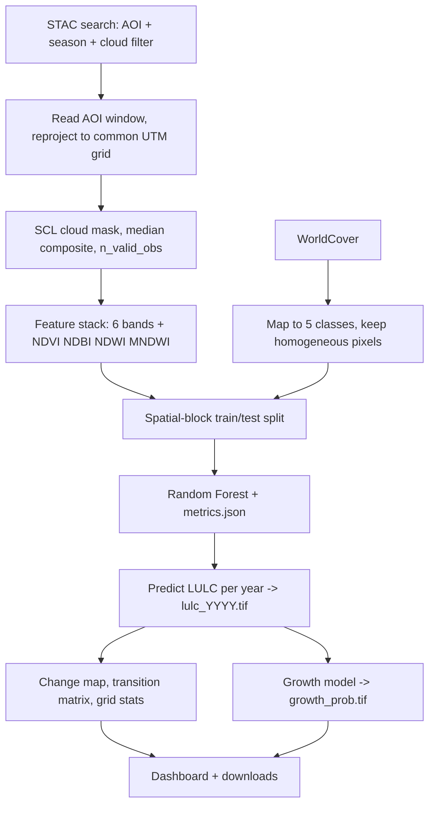
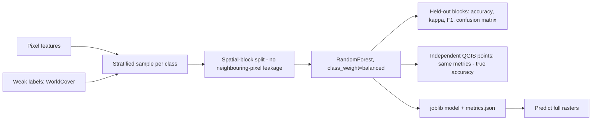

# System architecture

All diagrams are Mermaid (render on GitHub, VS Code with the Mermaid extension, or https://mermaid.live).

## 1. Architecture overview


## 2. Data flow


## 3. Module interaction
```mermaid
flowchart LR
  CFG[config.yaml] --> RUN[scripts/run_pipeline.py]
  RUN --> PIPE[src/pipeline.py] --> ACQ[acquisition] & CHK[preprocessing] & MODEL[model] & GIS[gis_stats] & GROW[growth] & ENVM[environment]
  MODEL & GIS & GROW & ENVM --> OUT[(outputs/real | outputs/synthetic)]
  OUT --> APP[app/app.py] --> VIZ[viz.py] & INS[insights.py]
```

## 4. AI/ML pipeline

